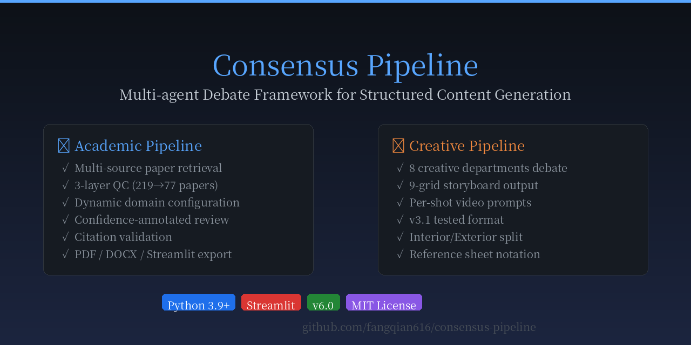
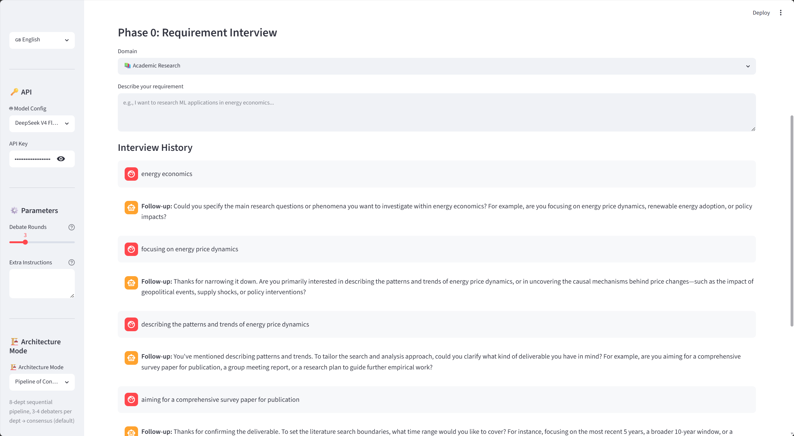
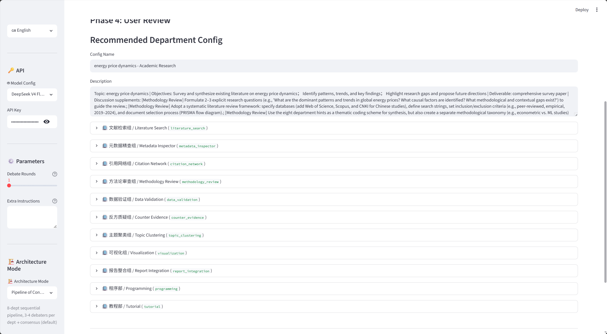
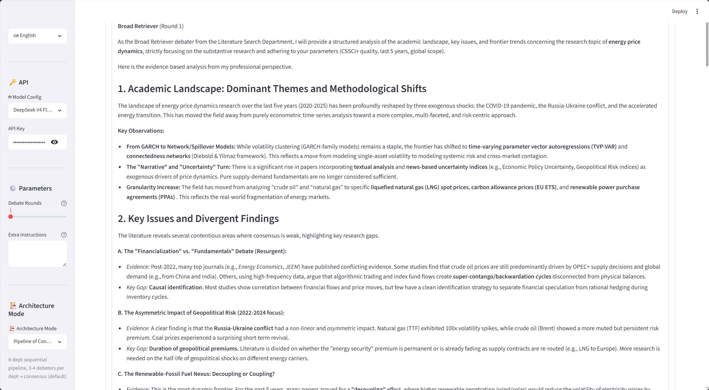
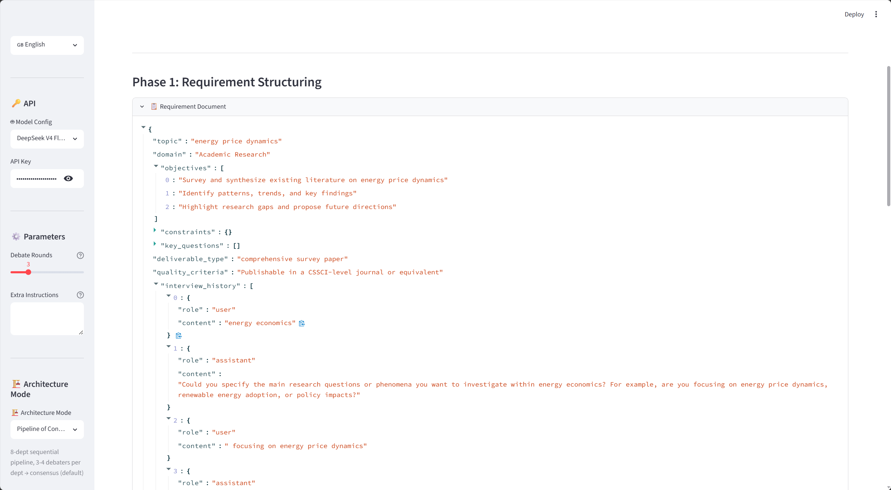
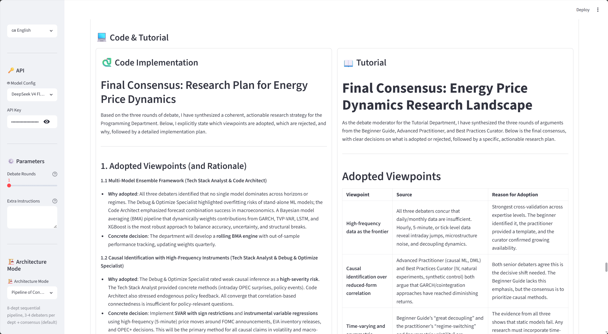
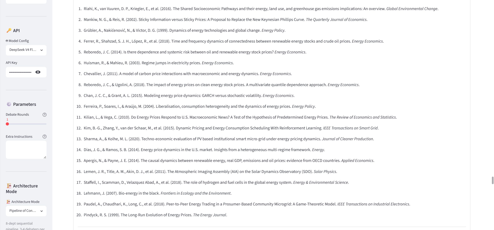
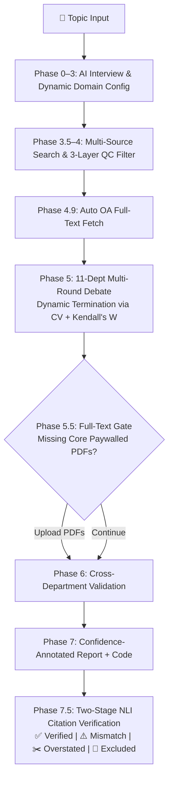

# 🧠 Consensus Pipeline

<p align="center">
  
</p>

<p align="center">
  
  
  
  
  
</p>

<p align="center">
  📖 <a href="README_CN.md">中文文档</a> ·
  ⚡ <a href="#-quick-start">Quick Start</a> ·
  🏗️ <a href="#️-how-it-works">Architecture</a> ·
  📖 <a href="#-usage">Usage</a> ·
  📦 <a href="https://github.com/fangqian616/consensus-pipeline/releases">Releases</a> ·
  🔗 <a href="https://github.com/fangqian616/multivest">Related: Multivest</a>
</p>

> **Multi-agent debate framework for academic research.**
> Instead of one AI writing a literature review for you — an AI team interviews you, debates each claim across methodological perspectives, reaches consensus via dynamic mathematical convergence, and verifies every citation against source abstracts and full texts.

---

## ⚡ Quick Start

Pick the fastest way to get running (see [📖 Usage](#-usage) for full configuration, full-text PDF breakpoint, and custom endpoints):

**🚀 1. One-shot installer (Clones + Installs Deps + Prints MCP Config)**

```bash
# Windows PowerShell
irm https://github.com/fangqian616/consensus-pipeline/raw/main/install.ps1 | iex

# macOS / Linux
curl -fsSL https://github.com/fangqian616/consensus-pipeline/raw/main/install.sh | bash
```

**🤖 2. DSH Plugin (AI-Driven with Floating Control Panel)**

```bash
git clone --depth 1 https://github.com/fangqian616/consensus-pipeline.git
npx -p @deepseek-ai/dsh dsh plugin --profile web add file:./consensus-pipeline/dsh-plugin
```
Tell DSH `"consensus-pipeline start"` (or `"共识管线开始需求调研"`) to launch the interview and debate pipeline.

**🖥️ 3. Local Streamlit Web UI / Headless CLI**

```bash
git clone https://github.com/fangqian616/consensus-pipeline.git && cd consensus-pipeline
pip install -r requirements.txt
export DEEPSEEK_API_KEY="sk-your-key-here"        # PowerShell: $env:DEEPSEEK_API_KEY="sk-..."

streamlit run app.py                              # Interactive Web UI
python run_pipeline_v2.py --topic "Your Topic"    # Headless v2 CLI
```

---

## ❓ Why Not Just Ask ChatGPT or Elicit?

A single LLM produces confident-sounding answers with no cross-validation — hallucinations slip through, conflicting perspectives get flattened, and you cannot tell which conclusions are robust vs. speculative.

Consensus Pipeline replaces one-shot generation with **structured multi-agent debate as a quality gate**: every claim is challenged by independent "departments," contradictions are surfaced explicitly, and final conclusions carry **per-claim confidence annotations** (e.g., `"42/77 papers, high confidence"`).

| Dimension | Single LLM (ChatGPT) | Elicit / Consensus.app | **Consensus Pipeline** |
|---|---|---|---|
| **Core Mechanism** | One-shot generation | Single-pass extraction | **11-Department Adversarial Debate** |
| **Stopping Rule** | Single turn | Fixed top-$k$ retrieval | **Dynamic Convergence ($CV$ + Kendall's $W$)** |
| **Contradictions** | Flattened / averaged out | Listed side-by-side | **Cross-examined across methodological perspectives** |
| **Citation Audit** | Hallucination-prone | Abstract snippet match | **2-Stage NLI (Abstract + Full-Text) & Mismatch Tagging** |

---

## 📸 What It Looks Like

### Step 1: Requirement Interview
The pipeline starts by interviewing you — an AI agent asks clarifying questions to understand your research scope, constraints, and goals.



### Step 2: Smart Department Configuration
Based on your topic, the AI auto-generates 10+ specialized debate departments with multiple debaters per department. Each debater argues from a distinct methodological perspective.



### Step 3: Multi-Round Debate with Dynamic Convergence
Watch debaters argue in real time. Each round, debaters present positions, challenge assumptions, and refine arguments. The pipeline runs 3–8 rounds per department, stopping early once debaters converge via stance coefficient of variation ($CV$) and Kendall's $W$.



### Step 4: Structured Output
Debate results are structured into JSON with clear roles, positions, and consensus points — ready for report synthesis.



### Step 5: Report with Confidence Annotations
The final report includes per-claim confidence scores, methodology comparison matrices, and verified citations. Every conclusion tells you exactly how many papers support it.

Full example report (148 papers, energy economics): see `examples/final_report.md`

### Bonus: Auto-Generated Code & Verified References
The pipeline also generates runnable Python code for key empirical/modeling methods and compiles a verified reference list.

<p align="center">
  
  
</p>

### Example Report Excerpt

> **Deep learning methods dominate short-term energy load forecasting** *(42/77 papers, high confidence)*
>
> LSTM and Transformer-based models consistently outperform traditional ARIMA methods by 10–40% in MAE metrics across multiple benchmark datasets. However, the **methodology review department flagged** widespread data leakage concerns — several studies used overlapping train/test splits that inflated apparent accuracy gains.
>
> **Graph neural networks show emerging potential in energy network optimization** *(3/77 papers, low confidence — trend not established)*
>
> While GNNs demonstrate structural advantages for modeling grid topology, current evidence is limited to small-scale test networks (< 100 nodes). Cross-department validation rated this claim as "promising but insufficiently validated."

---

## 🎯 Core Capabilities

**The pipeline in one sentence:** Search papers → 3-layer QC filter → 11 departments debate each claim → cross-department validation → generate confidence-annotated report with NLI citation verification.

- 🔍 **Multi-Source Paper Search & 3-Layer QC** — Queries OpenAlex + Semantic Scholar + arXiv with automatic deduplication, followed by a `hard_filter → LLM_classify → tag_layer` sieve (~65% off-topic exclusion rate).
- 🏛️ **11-Department Adversarial Debate** — 2–4 specialized debaters per department with cross-department consensus handoff (eliminating isolated debate silos) and dynamic convergence ($CV$ + Kendall's $W$).
- 📊 **Per-Claim Confidence & Faithful Paraphrase** — Every conclusion is tagged with supporting paper counts; strict transcription rules prevent fabricated data levels or mechanism directions.
- ✅ **Two-Stage NLI Citation Verification** — Every claim is checked against retrieved abstracts and full texts, explicitly distinguishing **citation mismatch (⚠️ wrong paper)** from **overstatement (✂️ wording too strong)** while excluding unverifiable claims (📖 needs-fulltext / 📭 title-only) from polluting confidence scores.
- 📄 **Full-Text Breakpoint & Multi-Format Export** — Auto-fetches OA full texts (Unpaywall/S2/OpenAlex), pauses at Phase 5.5 for interactive paywalled PDF supplementation, and exports bilingual reports (Markdown / DOCX / PDF) plus runnable Python code.

<details>
<summary><b>📋 Click to expand the complete 18-point technical feature checklist</b></summary>

- ✅ Multi-source paper search (OpenAlex + Semantic Scholar + arXiv)
- ✅ 3-layer QC: hard filter → LLM classify → importance tagging (219 → 77 papers, ~65% exclusion)
- ✅ 10–11 debate departments, each with 2–4 debaters arguing from different perspectives
- ✅ Multi-round debate with **dynamic termination** — stance quantification ($CV$) + Kendall's $W$ agreement
- ✅ Cross-department validation (one department audits another's conclusions)
- ✅ Per-claim confidence annotation (e.g., `"42/77 papers, high confidence"`)
- ✅ NLI citation verification — per-claim verdicts (✅/⚠️/❌), with unverifiable claims (📖 needs-fulltext / 📭 title-only) explicitly excluded from the confidence score
- ✅ Citation-mismatch vs. overstatement classification — ⚠️ wrong-paper citation vs. ✂️ overstated wording
- ✅ Full-text NLI upgrade — abstract-neutral claims auto-recheck against full text (OA or uploaded PDF)
- ✅ Meta-narrative claim filtering — report self-statistics ("this review included 215 papers") excluded from verification
- ✅ Department-to-department consensus handoff — later departments build upon earlier conclusions
- ✅ Faithful-paraphrase rule — strictly transcribes explicit paper statements without inventing mechanisms
- ✅ Full-text supplementation system — Phase 5.5 breakpoint prompts for missing-but-necessary paywalled PDFs
- ✅ Seed-paper force-inclusion — user-uploaded PDFs marked `weight=core` and guaranteed report inclusion
- ✅ Auto-generated runnable Python code for research methods
- ✅ Bilingual output (`--lang en` or `--lang zh`) with Markdown / DOCX / PDF export
- ✅ Streamlit UI with real-time debate monitoring + manual/auto convergence modes
- ✅ Zero-dependency MCP server + DSH control panel + One-shot cross-platform installers

</details>

### What's Still Rough
- ⚠️ Some UI labels remain bilingual (Chinese/English mix) in English mode.
- ⚠️ No GPU required, but a full multi-department run is an offline batch job (time and token usage scale with paper count).
- ⚠️ Cross-department pairing logic currently uses a basic two-layer fallback.

---

## 🏗️ How It Works



| Phase | Stage | What Happens |
|-------|-------|-------------|
| **0** | Requirement Interview | AI interviews you about scope, constraints & goals |
| **0.5** | Domain Config | AI generates domain config dynamically (zero hardcoding) |
| **1–3** | Structuring & Config | Scope extraction, multi-angle discussion & department config recommendation |
| **3.5** | QC Gate | 3-layer quality filter: `hard_filter → LLM_classify → tag_layer` |
| **4** | Paper Search | OpenAlex + Semantic Scholar + arXiv — deduplication & abstract backfill |
| **4.9** | Full-Text Fetch | Auto-fetch OA full text (Unpaywall → Semantic Scholar → OpenAlex) |
| **5** | Department Debate (v2) | 11 departments debate; stance quantification ($CV$) + Kendall's $W$ → dynamic termination |
| **5.5** | Full-Text Gate | Interactive breakpoint — import missing-but-necessary paywalled PDFs |
| **6** | Cross-Debate | Departments cross-validate each other's conclusions |
| **7** | Report Generation | Literature review + confidence annotations + runnable code + PDF/DOCX export |
| **7.5** | Citation Verification | NLI verification of every claim against source abstracts and full texts |

### 11 Research Departments

| Department | What They Debate |
|-----------|-----------------|
| **Literature Search** | Database selection, query formulation, recall vs. precision trade-offs |
| **Metadata Inspector** | DOI verification, metadata completeness, source reliability |
| **Citation Network** | Citation topology, impact metrics, seminal work mapping |
| **Methodology Review** | 7-dimension evaluation: accuracy, efficiency, interpretability, leakage, etc. |
| **Data Validation** | Dataset quality, reproducibility, sample biases |
| **Counter-Evidence** | Anti-mainstream findings, null results, controversy identification |
| **Topic Clustering** | Thematic grouping, paradigm shifts, research gap identification |
| **Visualization** | Chart design, distribution patterns, visual data representation |
| **Report Integration** | Synthesizing cross-department consensus into a cohesive narrative |
| **Programming** | Tool/library selection, runnable empirical/modeling code generation |
| **Tutorial** | Methodological guidance and workflow reproduction steps |

### Citation Verification Report (NLI) & Full-Text Supplementation

After the report is generated, a dedicated NLI verifier checks **every claim against retrieved abstracts and available full texts** with author metadata injected to confirm paper identity first:
- ✅ **Verified** — directly entailed by the source text
- ⚠️ **Partially verified** — partially supported, or classified as **Citation Mismatch** (wrong paper cited) / ✂️ **Overstated Claim** (right paper, wording too strong)
- ❌ **Contradicted** — source text directly refutes the claim
- ❓ **Unverified** — insufficient evidence (counted in confidence denominator)
- 📖 **Needs full-text** / 📭 **Title-only** — honestly separated and **excluded from scoring** so missing abstracts never silently distort confidence metrics.

**Closing the Paywall Gap in Two Steps:**
1. **Phase 4.9 (Automatic):** Crawls OA full texts via Unpaywall, Semantic Scholar, and OpenAlex, plus local PDFs in `fulltext_papers/`.
2. **Phase 5.5 (Interactive Breakpoint):** Identifies consensus-cited papers lacking full text and pauses for targeted PDF upload (via the DSH Control Panel with auto-DOI extraction, or by dropping files into `fulltext_papers/` and running `--rerun-67`). All user-imported papers are tagged `weight=core` for guaranteed inclusion.

---

## 📖 Usage

### 🚀 Way 1: One-Shot Installer (Recommended)

Clones the repository, installs Python dependencies (`python3.10+` and `git` required), and outputs your ready-to-paste `mcp.json` configuration:

```powershell
# Windows (PowerShell)
irm https://github.com/fangqian616/consensus-pipeline/raw/main/install.ps1 | iex
```

```bash
# macOS / Linux
curl -fsSL https://github.com/fangqian616/consensus-pipeline/raw/main/install.sh | bash
```

---

### 🤖 Way 2: AI Agent (DSH / MCP)

#### DSH (DeepSeek Harness) — Native Tools + Control Panel

```bash
git clone --depth 1 https://github.com/fangqian616/consensus-pipeline.git
npx -p @deepseek-ai/dsh dsh plugin --profile web add file:./consensus-pipeline/dsh-plugin
```

On first use, the plugin auto-clones the project to `~/.dsh/consensus-pipeline`.
1. **Start via Chat:** Say `"consensus-pipeline start"` (or `"共识管线开始需求调研"`) to begin the requirement interview.
2. **Live Monitoring:** Click the **📊 Control Panel (控制台)** floating button (bottom-right) to inspect live progress, atomic NLI verification cards, and batch PDF uploads.
3. **Phase 5.5 Breakpoint:** Use the **⏳ pending-import list** in the panel to pause, drop in paywalled PDFs, and click one-click re-verify.

#### Any MCP Client (Claude Desktop / Cursor / Codex)

Point any MCP client to the zero-dependency `mcp_server.py`:

```json
{
  "mcpServers": {
    "consensus-pipeline": {
      "command": "python",
      "args": ["/path/to/consensus-pipeline/mcp_server.py"]
    }
  }
}
```

---

### 🖥️ Way 3: Streamlit Web UI / Headless CLI

#### Streamlit Web UI
```bash
streamlit run app.py
```
Opens `http://localhost:8501`. Configure your API key and language in the sidebar, complete the interactive interview, customize generated departments, and monitor multi-round debates live.

#### Headless CLI (v2 Recommended)
```bash
# Run full v2 pipeline (English or Chinese)
python run_pipeline_v2.py --topic "Machine Learning in Energy Economics" --lang en
python run_pipeline_v2.py --topic "碳市场价格预测与能源转型关联机制研究" --lang zh

# Optional: Run Phase 0-3 requirement research standalone
python run_requirement_research.py --topic "Your Research Topic"

# Re-run ONLY report generation + NLI verification after adding PDFs to fulltext_papers/
python run_pipeline_v2.py --topic "Your Research Topic" --output-dir "v2_run_output/<run-dir>" --rerun-67
```

Outputs are saved to `v2_run_output/<date>_<topic>/` (Markdown/DOCX/PDF reports, `citation_verification.json`, debate logs, and charts).

---

## ⚙️ Configuration & Prerequisites

- **Runtime:** Python 3.10+ (3.11+ recommended), `git`, internet access (no GPU or local database needed).
- **Environment Variables:**

| Variable | Required | Description |
|----------|----------|-------------|
| `DEEPSEEK_API_KEY` | ✅ Yes | API key for LLM calls ([Register](https://platform.deepseek.com/) or use any OpenAI-compatible key) |
| `DEEPSEEK_MODEL` | No | Model override (e.g., `deepseek-v4-flash` for debate, `deepseek-v4-pro` for verification) |
| `EASYSCHOLAR_SECRET_KEY` | No | Optional enhanced journal ranking (falls back to built-in 209-journal registry) |

| Provider | API Endpoint | Tested Models |
|----------|-------------|---------------|
| **DeepSeek** | `https://api.deepseek.com/v1` | `deepseek-v4-flash`, `deepseek-v4-pro` |
| **OpenAI** | `https://api.openai.com/v1` | `gpt-4o` |
| **Custom** | Any OpenAI-compatible URL | Local or cloud OpenAI-compatible models |

---

## 📁 Project Structure

```text
consensus-pipeline/
├── install.ps1 / install.sh     # One-shot installers (clone + pip + mcp.json)
├── app.py                       # Streamlit main Web UI
├── router.py                    # AI Router — smart department configuration
├── debate_engine.py             # Core multi-agent debate engine
├── run_pipeline_v2.py           # CLI runner (v2) — stance quantification + dynamic termination
├── stance_quant_v2.py           # v2 stance quantification (CV + Kendall's W convergence)
├── run_requirement_research.py  # Standalone requirement research (Phase 0-3)
├── paper_importer.py            # Seed-paper import (PDF → metadata + DOI extraction)
├── mcp_server.py                # Zero-dependency MCP server
├── panel.html                   # DSH control panel (verification cards + full-text upload)
├── dsh-plugin/                  # DSH plugin bundle (mounts /consensus-pipeline/ + native tools)
├── fulltext_papers/             # User-uploaded paywalled PDFs (gitignored)
├── quality_controller.py        # 3-layer QC filter department
├── domain_config_generator.py   # Zero-hardcoding dynamic domain generator
├── docx_exporter.py / pdf_exporter.py
├── academic/                    # Multi-source search, 209-journal registry, cross-validator & charts
└── requirement/                 # Interviewer, structurer, NLI citation_verifier & fact_checker
```

---

## 🗺️ Roadmap

| Priority | Feature | Status |
|----------|---------|--------|
| P0 | Unify remaining bilingual UI labels in English mode | In progress |
| P1 | Two-stage semantic NLI citation verification | ✅ Shipped in v0.12 |
| P1 | Sub-topic query decomposition & splitting | Planned |
| P1 | Publication bias detection (funnel plot diagnostics) | Planned |
| P2 | Cross-language retrieval (CNKI + bilingual alignment) | Planned |
| P2 | Incremental literature update & delta debate | Planned |
| P2 | Standardized benchmark for multi-agent debate quality | Planned |

---

## ❓ FAQ

**Q: How is this different from Elicit or Consensus.app?**
A: Those tools extract and summarize in a single pass. Consensus Pipeline forces every finding through multi-round adversarial debate across 11 specialized departments before it can enter the report — surfacing methodological flaws (such as train/test data leakage) that single-pass summarizers miss.

**Q: Is the multi-agent debate overhead actually worth it?**
A: Yes. In side-by-side comparisons on energy forecasting literature, single-pass generation only reported the 10–40% MAE improvement of deep learning models. With multi-agent debate, the Methodology Review department concurrently flagged widespread data leakage in those exact benchmarks, preserving both the accuracy gain and the methodological caveat in the final synthesis.

**Q: How long does a run take and how much does it cost?**
A: A full run is a background batch job whose duration scales with retrieved paper count and active departments. Using DeepSeek APIs, a complete multi-department run costs only a fraction of a dollar.

---

## 🔗 Related Projects

### [Multivest · 智能多维投资系统](https://github.com/fangqian616/multivest)

A desktop research system for Chinese household asset allocation by the same author. It shares the core mathematical convergence mechanism from this pipeline — quantifying agent stances on a Likert scale and terminating debate when the stance coefficient of variation falls below $\varepsilon_1$ while Kendall's $W$ confirms rank concordance — applied to a fixed panel of financial analysts auditing a portfolio.

| Dimension | Consensus Pipeline | Multivest |
|---|---|---|
| **Input** | An academic research question | Household portfolio + daily market data |
| **Agent Topology** | 11 departments generated per topic | Fixed analyst panel + chief investment officer |
| **Quantitative Basis** | Extracted from literature, NLI-verified | Computed by deterministic engine; LLM judges |
| **Delivery** | Streamlit UI + MCP server + CLI | Standalone Windows app (PyInstaller + WebView2) |

---

## 🤝 Contributing & License

PRs, bug reports, new debater personas, and evaluation benchmarks are warmly welcome! Released under the **MIT License**.

> Actively developed for rigorous empirical and literature workflows. If Consensus Pipeline helps your research, a ⭐ on GitHub means a lot — it helps other researchers discover the project!
