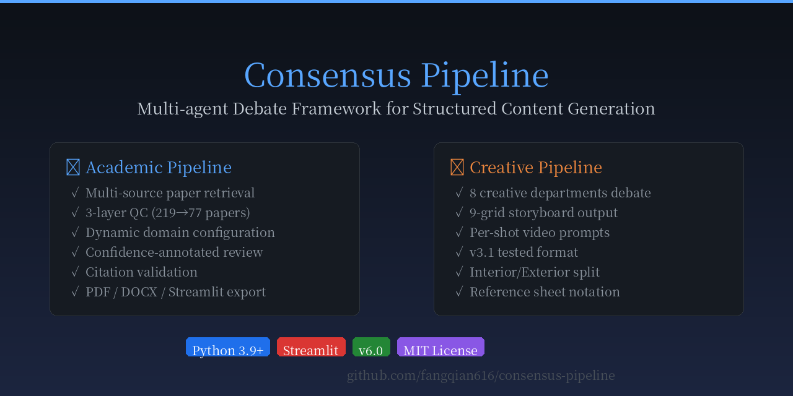
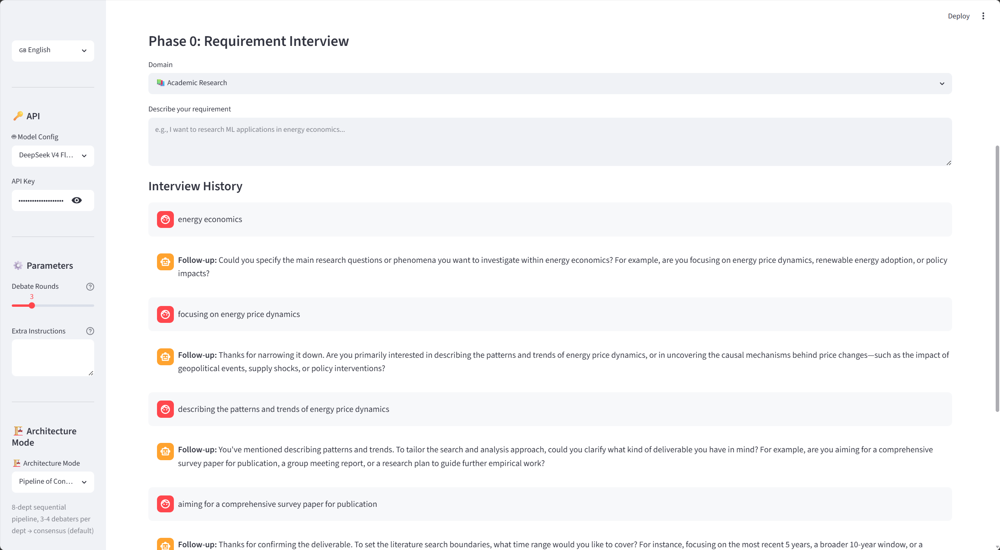
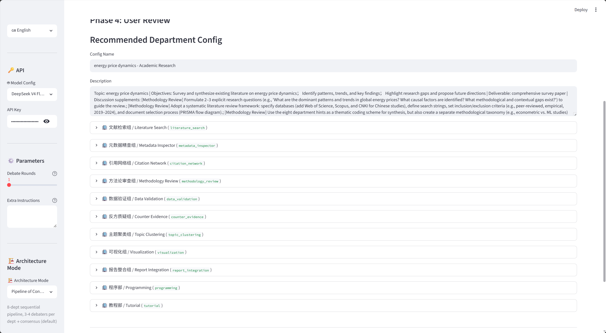
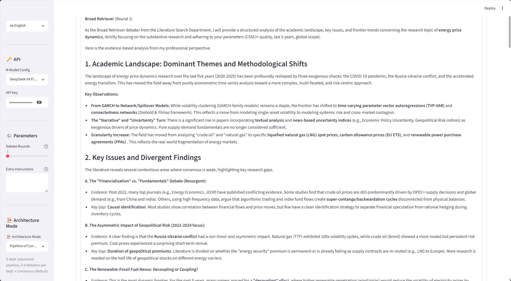
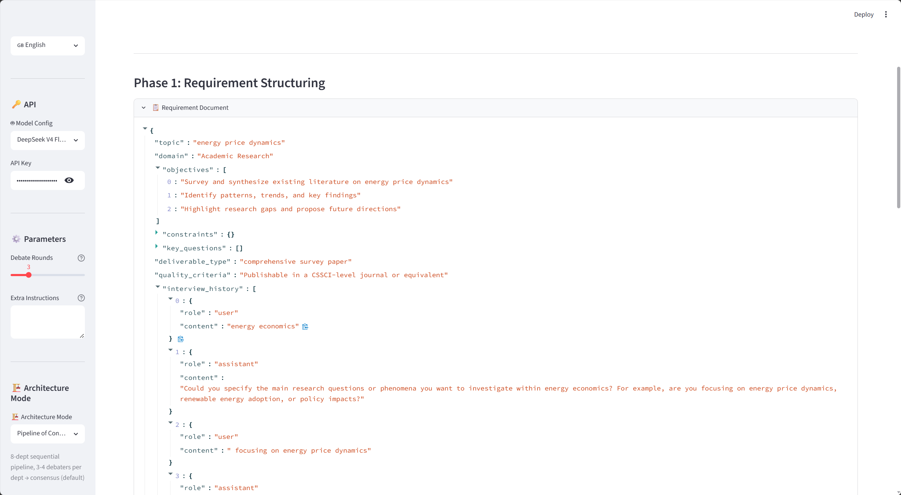
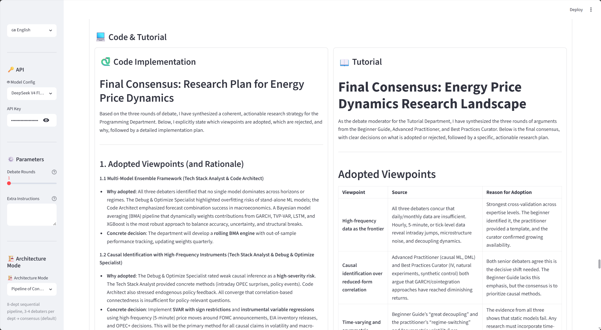
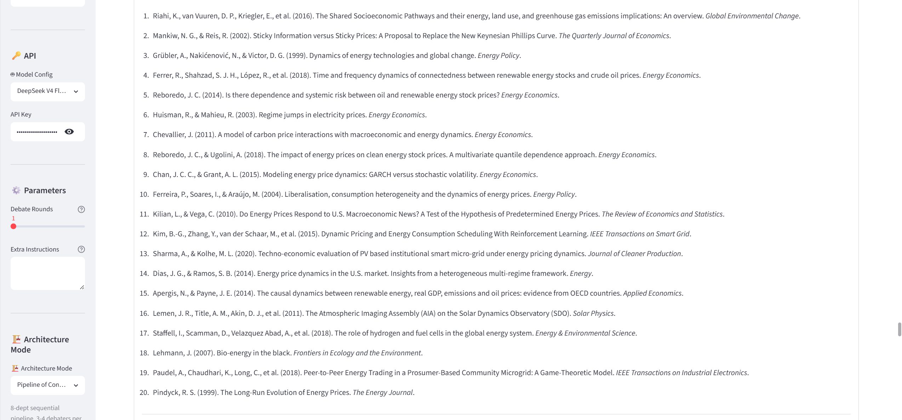
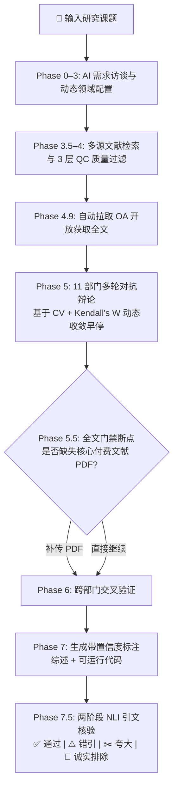

# 🧠 Consensus Pipeline（学术共识辩论管线）

<p align="center">
  
</p>

<p align="center">
  
  
  
  
  
</p>

<p align="center">
  📖 <a href="README.md">English README</a> ·
  ⚡ <a href="#-快速开始">快速开始</a> ·
  🏗️ <a href="#️-核心架构与工作流">核心架构</a> ·
  📖 <a href="#-使用指南">使用指南</a> ·
  📦 <a href="https://github.com/fangqian616/consensus-pipeline/releases">版本发布</a> ·
  🔗 <a href="https://github.com/fangqian616/multivest">关联项目: Multivest</a>
</p>

> **面向严谨学术研究的多智能体对抗辩论框架（Multi-Agent Debate Framework）。**
> 告别“单一 AI 替你盲写文献综述”——在这里，AI 团队会先对你进行需求访谈，随后由 11 个专业方法论部门对每项学术论断展开多轮对抗辩论，通过数学收敛机制达成共识，并对每一条结论标注置信度、逐一比对原文摘要与全文进行 NLI 引文核验。

---

## ⚡ 快速开始

任选以下三种方式之一即可启动（完整配置、付费文献断点补传与自定义接口详见 [📖 使用指南](#-使用指南)）：

**🚀 1. 一键安装脚本（最省心：自动克隆 + 安装依赖 + 输出 MCP 配置）**

```bash
# Windows PowerShell
irm https://github.com/fangqian616/consensus-pipeline/raw/main/install.ps1 | iex

# macOS / Linux
curl -fsSL https://github.com/fangqian616/consensus-pipeline/raw/main/install.sh | bash
```

**🤖 2. DSH 插件模式（AI 驱动，自带右下角可视化悬浮控制台）**

```bash
git clone --depth 1 https://github.com/fangqian616/consensus-pipeline.git
npx -p @deepseek-ai/dsh dsh plugin --profile web add file:./consensus-pipeline/dsh-plugin
```
安装后直接对 DSH 说 **“共识管线开始需求调研”**（或 `"consensus-pipeline start"`），即可自动执行“需求访谈 → 部门配置 → 多轮辩论 → 置信度标注报告”，并通过右下角 **📊 控制台** 实时查看原子级核验与上传全文 PDF。

**🖥️ 3. 本地 Streamlit 网页端 / 命令行 CLI**

```bash
git clone https://github.com/fangqian616/consensus-pipeline.git && cd consensus-pipeline
pip install -r requirements.txt
export DEEPSEEK_API_KEY="sk-your-key-here"        # PowerShell: $env:DEEPSEEK_API_KEY="sk-..."

streamlit run app.py                              # 启动可视化网页端
python run_pipeline_v2.py --topic "你的研究课题"   # 运行 v2 无头命令行管线
```

---

## ❓ 为什么不直接问 ChatGPT 或用 Elicit？

单一 LLM 生成的综述听起来自信满满，实则缺乏交叉验证——幻觉难以察觉、对立学术观点被强行抹平，研究者根本无法区分哪些结论是学界共识、哪些只是个别文献的孤证。

Consensus Pipeline 将**结构化多智能体对抗辩论作为质量门禁（Quality Gate）**：每一条结论都必须经受独立“方法论部门”的质询与挑刺，争议焦点被显式保留，且最终结论全部附带**证据数量与置信度标注**（例如：`42/77 篇文献支持，高置信度`）。

| 对比维度 | 单一模型 (ChatGPT) | Elicit / Consensus.app | **Consensus Pipeline** |
|---|---|---|---|
| **核心生成机制** | 单次直接生成 | 单轮检索提取与摘要 | **11 个专业部门多轮对抗辩论** |
| **停止与收敛准则** | 单回合结束 | 固定 Top-$k$ 截断 | **动态数学收敛（变异系数 $CV$ + Kendall's $W$）** |
| **学术争议处理** | 模糊折中 / 抹平冲突 | 简单罗列摘要片段 | **跨方法论视角交叉质询，显式暴露数据与识别缺陷** |
| **引文真实性核验** | 极易产生伪造引文 | 仅匹配摘要关键词 | **两阶段 NLI 核验（摘要+全文），精准区分“引错文献”与“表述夸大”** |

---

## 📸 运行界面与输出预览

### Step 1: 需求访谈（Requirement Interview）
管线启动后，AI 访谈智能体会先向你提问，精准界定研究范围、纳入排除标准与核心关注问题。



### Step 2: 智能部门配置（Smart Department Configuration）
根据研究课题，系统零硬编码自动生成 10+ 个专业辩论部门，每个部门配备多名持不同方法论立场的辩手。



### Step 3: 多轮对抗辩论与动态收敛（Multi-Round Debate）
实时观测各部门辩手交锋。辩手在每轮阐述立场、质疑对方假设并修正论点。默认运行 3–8 轮，一旦立场变异系数（$CV$）与肯德尔和谐系数（Kendall's $W$）达标即触发动态早停。



### Step 4: 结构化共识输出（Structured Output）
辩论结果被结构化封装为 JSON，清晰记录各方角色、争鸣焦点与最终共识，直接驱动报告合成。



### Step 5: 附带置信度标注的综述报告（Confidence-Annotated Report）
最终报告包含逐条结论的置信度评分、方法论对比矩阵以及经过核验的参考文献列表（完整 148 篇能源经济学示例报告见 `examples/final_report.md`）。

### Bonus: 自动生成可运行代码与核验引文库
管线还会针对核心研究方法自动生成可运行的 Python 示例代码，并输出核验通过的文献列表。

<p align="center">
  
  
</p>

### 真实报告片段示例

> **深度学习方法在短期能源负荷预测中占主导地位** *(42/77 篇文献，高置信度)*
>
> 在多个基准数据集上，基于 LSTM 和 Transformer 的模型在 MAE 指标上比传统 ARIMA 方法稳定降低 10%–40%。然而，**方法论审查部门（Methodology Review）指出**存在普遍的数据泄露隐患——多篇文献使用了重叠的训练/测试集划分，人为夸大了表观精度增益。
>
> **图神经网络（GNN）在能源网络优化中展现出新兴潜力** *(3/77 篇文献，低置信度 — 趋势尚未确立)*
>
> 尽管 GNN 在刻画电网拓扑结构上具备天然优势，但现有实证证据仅局限于小规模测试网络（< 100 个节点）。跨部门交叉验证将该结论评定为“前景可期但验证不足”。

---

## 🎯 核心能力

**一句话概括管线流程：** 多源文献检索 → 3 层 QC 质量过滤 → 11 个部门逐条辩论 → 跨部门交叉验证 → 生成带置信度标注与 NLI 引文核验的结构化综述。

- 🔍 **多源检索与 3 层 QC 过滤** — 聚合 OpenAlex + Semantic Scholar + arXiv 并自动去重，经由 `硬过滤 → LLM 领域分类 → 核心度分层` 三道筛子剔除约 65% 偏题文献。
- 🏛️ **11 部门多智能体对抗辩论** — 打破部门孤岛，支持跨部门共识传递（前序部门结论向后序公开）与基于 $CV$ + Kendall's $W$ 的动态终止。
- 📊 **逐条置信度标注与忠实转述准则** — 每项结论标注文献支撑数；严格执行忠实转述规则（Faithful-Paraphrase），杜绝模型脑补数据层级或机制方向。
- ✅ **两阶段 NLI 引文核验（区分错引与夸大）** — 注入作者元数据核对文献身份，对摘要中立的论断自动抓取全文二次核验；精准区分 **⚠️ 文献错引（Citation Mismatch）** 与 **✂️ 表述夸大（Overstatement）**，并将无法仅靠摘要判断的条目（📖 需全文 / 📭 仅标题）诚实剥离，绝不污染置信度得分。
- 📄 **付费文献断点补传与多格式导出** — Phase 4.9 自动拉取 OA 全文，Phase 5.5 交互式断点精准提示需手动补传的少量核心付费 PDF（支持拖拽上传自动解析 DOI），用户导入文献标记 `weight=core` 强制纳入报告，支持中英双语 Markdown / DOCX / PDF 导出。

<details>
<summary><b>📋 点击展开完整 18 项技术特性清单</b></summary>

- ✅ 多源文献检索（OpenAlex + Semantic Scholar + arXiv 自动去重与摘要回填）
- ✅ 3 层 QC 质量门禁：硬规则过滤 → LLM 领域分类 → 重要性分层（能源经济学实测 219 → 77 篇，剔除率 64.8%）
- ✅ 10–11 个专业辩论部门，每部门 2–4 名不同视角辩手
- ✅ 动态终止机制：基于立场变异系数（$CV$）+ 肯德尔和谐系数（Kendall's $W$）自动判定收敛
- ✅ 跨部门交叉验证（Cross-Department Validation）
- ✅ 逐条结论置信度标注（如 `42/77 papers, high confidence`）
- ✅ NLI 自然语言推理引文核验（✅ 验证通过 / ⚠️ 部分支持 / ❌ 矛盾 / 📖 需全文排除计分）
- ✅ 错引（⚠️ Wrong Paper）与夸大（✂️ Overstated Wording）细粒度归因
- ✅ 全文 NLI 自动升级：摘要中立条目自动调取 OA 全文或用户上传 PDF 重新核验
- ✅ 元叙事过滤：自动剔除报告自述性统计句（如“本综述共纳入 215 篇文献”），防止干扰核验分母
- ✅ 部门间共识接力（Consensus Handoff）：后序部门可读取前序部门共识，消除辩论孤岛
- ✅ 忠实转述铁律：严禁捏造原文未提及的样本层级或因果机制方向
- ✅ Phase 5.5 交互式全文补传断点：仅筛选“被共识实际引用且缺失全文”的关键文献请求补传
- ✅ 种子文献强制纳入：用户上传的 PDF 自动标记 `weight=core`，确保进入最终综述
- ✅ 核心研究方法可运行 Python 代码自动生成
- ✅ 中英双语输出（`--lang zh` / `--lang en`）及 Markdown / Word (DOCX) / PDF 导出
- ✅ Streamlit 实时辩论监控面板（支持自动/手动收敛切换）
- ✅ 零依赖原生 MCP Server + DSH 悬浮控制台 + 跨平台一键安装脚本

</details>

### 当前局限与待打磨项
- ⚠️ 英文模式下部分 UI 标签仍存在中英混排（正在清理中）。
- ⚠️ 无需 GPU，但完整跑通 11 个部门属于后台批处理任务（耗时与 Token 消耗随文献数量线性增长）。
- ⚠️ 跨部门配对审查目前采用基础的双层回退逻辑，尚未做自适应图路由优化。

---

## 🏗️ 核心架构与工作流



| 阶段 (Phase) | 名称 | 核心执行内容 |
|-------|-------|-------------|
| **0** | 需求访谈 | AI 智能体围绕研究范围、约束条件与核心目标进行多轮提问 |
| **0.5** | 动态领域配置 | 根据课题动态生成检索词轮转、排除信号与分层标准（零硬编码） |
| **1–3** | 结构化与部门推荐 | 提取范围约束、多视角需求研讨、生成辩论部门配置方案 |
| **3.5** | QC 质量门禁 | 3 层过滤：`hard_filter → LLM_classify → tag_layer` |
| **4** | 多源文献检索 | OpenAlex + Semantic Scholar + arXiv 检索、去重与缺失摘要回填 |
| **4.9** | 全文自动抓取 | 按 Unpaywall → Semantic Scholar → OpenAlex 顺序自动获取 OA 全文 |
| **5** | 部门对抗辩论 (v2) | 11 个部门展开多轮辩论；实时计算立场 $CV$ 与 Kendall's $W$ 实现动态早停 |
| **5.5** | 付费全文补传门禁 | 交互式断点——提取辩论实际引用但缺失全文的核心付费文献，提示用户按需补传 |
| **6** | 跨部门交叉辩论 | 部门间交叉复核结论，识别前后矛盾与过度推论 |
| **7** | 综述报告生成 | 生成文献综述 + 置信度标注 + 可运行代码 + DOCX/PDF 导出 |
| **7.5** | NLI 引文核验 | 将每条结论与源文献摘要/全文进行自然语言推理比对，输出核验报告 |

---

## 📖 使用指南

### 🚀 方式一：一键安装脚本（推荐）

一条命令自动完成仓库克隆、依赖安装并打印 MCP 配置文件片段（需预装 `git` 与 `Python 3.10+`）：

```powershell
# Windows (PowerShell)
irm https://github.com/fangqian616/consensus-pipeline/raw/main/install.ps1 | iex
```

```bash
# macOS / Linux
curl -fsSL https://github.com/fangqian616/consensus-pipeline/raw/main/install.sh | bash
```

---

### 🤖 方式二：AI 智能体驱动（DSH / MCP）

#### 1. DSH (DeepSeek Harness) 插件与控制台
```bash
git clone --depth 1 https://github.com/fangqian616/consensus-pipeline.git
npx -p @deepseek-ai/dsh dsh plugin --profile web add file:./consensus-pipeline/dsh-plugin
```
首次调用时插件会自动将完整项目克隆至 `~/.dsh/consensus-pipeline`：
1. **对话启动**：在聊天框输入 **“共识管线开始需求调研”**，AI 将自动开启访谈并推进管线。
2. **实时监控**：点击右下角 **📊 控制台** 悬浮按钮，查看实时辩论进度、原子级引文核验卡片，或批量拖拽上传全文 PDF（无论文件名如何，系统会自动从 PDF 内文提取 DOI 进行匹配）。
3. **Phase 5.5 断点续传**：在待导入列表（⏳ pending-import list）中可随时暂停、补传核心付费 PDF 并一键重新核验。

#### 2. 任意 MCP 客户端（Claude Desktop / Cursor / Codex）
本项目 `mcp_server.py` 采用纯 Python 标准库编写（零外部依赖），直接将以下配置加入客户端即可：

```json
{
  "mcpServers": {
    "consensus-pipeline": {
      "command": "python",
      "args": ["/path/to/consensus-pipeline/mcp_server.py"]
    }
  }
}
```

---

### 🖥️ 方式三：Streamlit 网页端 / 命令行 CLI

```bash
# 启动 Streamlit 交互式网页端（浏览器自动打开 http://localhost:8501）
streamlit run app.py

# 运行 v2 命令行管线（默认中文，支持 --lang en 切换英文）
python run_pipeline_v2.py --topic "碳市场价格预测与能源转型关联机制研究"
python run_pipeline_v2.py --topic "Machine Learning in Energy Economics" --lang en

# 可选：仅单独运行 Phase 0-3 需求调研与部门配置生成
python run_requirement_research.py --topic "你的研究课题"

# 将付费 PDF 放入 fulltext_papers/ 目录后，仅重跑“报告合成 + NLI 核验”阶段（复用已完成辩论）
python run_pipeline_v2.py --topic "你的研究课题" --output-dir "v2_run_output/<run-dir>" --rerun-67
```

所有运行产物保存在 `v2_run_output/<日期>_<课题>/` 目录下，包含 Markdown/DOCX/PDF 报告、`citation_verification.json` 核验账本、完整辩论日志及可视化图表。

---

## ⚙️ 环境要求与配置说明

- **基础环境**：Python 3.10+（推荐 3.11+）、`git`、正常网络连接（无需 GPU，无需配置本地数据库，文献检索全部基于免费开放学术 API）。
- **环境变量**：

| 变量名 | 是否必填 | 说明 |
|----------|----------|-------------|
| `DEEPSEEK_API_KEY` | ✅ 必填 | 用于驱动 LLM 的 API 密钥（[前往注册](https://platform.deepseek.com/)，或使用任意 OpenAI 兼容密钥） |
| `DEEPSEEK_MODEL` | 选填 | 自定义模型名称（如辩论用 `deepseek-v4-flash`，核验与报告用 `deepseek-v4-pro`） |
| `EASYSCHOLAR_SECRET_KEY` | 选填 | 增强期刊等级查询（不填则自动回退至内置的 209 本核心期刊本地注册表） |

---

## 🔗 关联项目

### [Multivest · 智能多维投资系统](https://github.com/fangqian616/multivest)

同一作者开发的中国家庭资产配置桌面端研究工具。该项目复用了本管线的两项核心收敛机制设计——在李克特量表（Likert scale）上量化每位辩论参与者的立场，并在立场变异系数低于阈值 $\varepsilon_1$ 且 Kendall's $W$ 确认排序一致性时触发收敛早停——将其迁移至固定金融分析师委员会对家庭投资组合的审阅场景中。两个仓库代码与依赖完全独立。

---

## 🤝 参与贡献与开源协议

非常欢迎提交 PR、Bug 反馈、新增辩手方法论视角或提供多智能体辩论质量的评估基准！本项目基于 **MIT License** 开源。

> 本项目专为严谨的实证研究与文献综述工作流持续迭代打磨。如果 Consensus Pipeline 对你的学术研究有所帮助，欢迎在 GitHub 点亮一颗 ⭐ Star，让更多研究者看到它！
